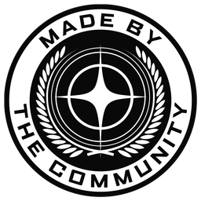

# Copilote vocal Star Citizen — téléchargement

Un copilote qui vous écoute, appuie sur les touches dans Star Citizen et vous répond à voix haute.
Tout tourne sur votre PC : reconnaissance vocale, voix et IA locale fonctionnent sans Internet.

```
Vous      : « Copilote, on se pose : demande à la tour et sors le train. »
Copilote  : « Contact avec la tour de contrôle. Train d'atterrissage sorti. »
```

## Télécharger

**[Dernière version](https://github.com/Grumf81/copilote-sc-telechargement/releases/latest)** : téléchargez **tous**
les fichiers de la version et mettez-les **dans le même dossier** :

- `CopiloteSC-Installation-<version>.exe` (le programme d'installation, à lancer)
- `CopiloteSC-Installation-<version>-1.bin`, `-2.bin`, `-3.bin` (les données, ~5,5 Go au total)

Windows ne sait pas lancer un programme de plus de 4 Go : les données sont donc à côté, en morceaux.

## Installer

1. Lancez `CopiloteSC-Installation-<version>.exe`. Windows SmartScreen peut afficher « Windows a protégé votre
   ordinateur » (le programme n'est pas signé) : *Informations complémentaires › Exécuter quand même*.
2. Aucun droit administrateur n'est demandé. Dossier par défaut : `%LOCALAPPDATA%\Programs\Copilote Star Citizen`
   (un autre disque peut être choisi, ~7 Go avec tous les composants).
3. Composants :
   - **Socle** (obligatoire) : copilote, Python, reconnaissance vocale, voix ;
   - **IA locale** (Qwen 2.5 3B) : répond aux questions sans Internet. Inutile si vous utilisez une IA en ligne ;
   - **Accélération NVIDIA** : reconnaissance vocale sur la carte graphique, plus rapide et plus précise. Décochée
     d'office sans carte NVIDIA.
4. À la fin, le copilote démarre et ouvre son interface : **http://127.0.0.1:4732**. Une icône apparaît près de
   l'horloge.

**Configuration conseillée** : Windows 10 ou 11 64 bits, 16 Go de RAM, un micro ou un casque. Une carte NVIDIA
(6 Go de mémoire vidéo ou plus) est recommandée, mais pas indispensable. Star Citizen en mode *Fenêtré sans bordure*
pour voir l'overlay.

## Mettre à jour, désinstaller

- **Mise à jour** : depuis le copilote, page **Mises à jour** › *Programme du copilote* › **Mettre à jour et
  redémarrer** (quelques secondes, rien à retélécharger). Le copilote vérifie chaque jour et n'installe rien sans
  votre accord. Vos réglages, commandes, voix et avatars sont conservés.
- Les copilotes installés avant la version du 22 octobre 2026 n'ont pas encore cette mise à jour intégrée :
  réinstallez une fois avec l'installateur le plus récent (même dossier, rien n'est perdu).
- **Désinstallation** : *Paramètres Windows › Applications › Copilote Star Citizen*. Elle propose de garder ou de
  supprimer vos réglages.

## Télécommande sur téléphone

Un seul écran ? Page **Téléphone** du copilote : autorisez la télécommande, puis scannez le QR code avec votre téléphone
(même Wi-Fi que le PC). Le téléphone affiche l'avatar animé, la conversation, les annonces du jeu et quelques réglages,
avec un bouton **Stop**. Les vues changent à la voix (« Copilote, affiche les annonces »). Aucune commande ne part du
téléphone : les ordres passent toujours par la voix. Windows demande une fois d'autoriser le copilote dans son pare-feu.

## Licences

Copilote vocal Star Citizen — créé par [Grumf81](https://github.com/Grumf81). Copyright © 2026 Plagnito — https://plagnito.com/

L'installateur contient aussi des logiciels et des modèles d'autres auteurs, chacun sous sa propre licence : voir
[LICENCES.md](LICENCES.md).

### Star Citizen, Cloud Imperium et Roberts Space Industries



Ceci est un **projet de fan non officiel**. Mention demandée par CIG :

> This project is not endorsed by or affiliated with the Cloud Imperium or Roberts Space Industries group of
> companies. All game content and materials are copyright Cloud Imperium Rights LLC and Cloud Imperium Rights Ltd.
> Star Citizen®, Squadron 42®, Roberts Space Industries®, and Cloud Imperium® are registered trademarks of
> Cloud Imperium Rights LLC. All rights reserved.

En français : ce projet n'est ni approuvé par le groupe de sociétés Cloud Imperium ou Roberts Space Industries, ni
affilié à lui. Tout le contenu et le matériel du jeu sont protégés par le copyright de Cloud Imperium Rights LLC et de
Cloud Imperium Rights Ltd. Star Citizen®, Squadron 42®, Roberts Space Industries® et Cloud Imperium® sont des marques
déposées de Cloud Imperium Rights LLC. Tous droits réservés.
